<p align="center">
  
</p>
<h1 align="center">BirdSuite</h1>
<p align="center"><i>The long-term monitoring edition of BirdNET-Pi</i></p>
<p align="center"><b>Turn a Raspberry Pi into a 24/7 bird observatory that listens, identifies, records and tells you what matters.</b></p>
<p align="center">
  
  
  <a href="LICENSE"></a>
</p>
<p align="center">
  <a href="#how-to-get-birdsuite"><b>Installation guide</b></a> ·
  <a href="#features"><b>Features</b></a> ·
  <a href="#screenshots"><b>Screenshots</b></a> ·
  <a href="https://github.com/EvaldoOliveira/BirdSuite/releases"><b>Releases</b></a> ·
  <a href="#reporting-issues"><b>Help</b></a>
</p>
<p align="center">
  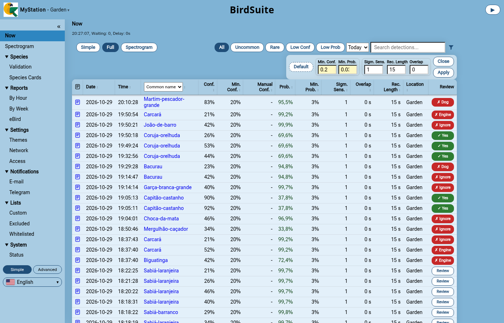
  <br><sub><i>The Latest page of the pilot station in São Paulo — BirdNET+ V3 with Brazilian (CBRO) names.</i></sub>
</p>
<p align="center"><sub>⚠️ <a href="LICENSE">Review the licence</a> — BirdSuite, like BirdNET-Pi, may not be used to develop a commercial product.</sub></p>

## More than bird identification

**BirdSuite** is an independent edition of BirdNET-Pi, maintained as a hard fork of
[Nachtzuster/BirdNET-Pi](https://github.com/Nachtzuster/BirdNET-Pi) — itself the maintained continuation of
[mcguirepr89/BirdNET-Pi](https://github.com/mcguirepr89/BirdNET-Pi) — from upstream commit `88985a3` (v0.11 line,
forked on 2026-08-29).

BirdSuite keeps everything BirdNET-Pi does — continuous recording, real-time identification, clip extraction, charts,
live audio — and adds what a station needs to run for years: the newest model, trustworthy data, notifications
that only interrupt you for what matters, and a station that tells you when something is wrong.

### Features

<table>
<tr>
<td width="33%" valign="top">

#### 🧠 V3 model and shadow models
**BirdNET+ V3** (about 10,000 classes) with its own location filter, or V2.4. A second model can run in **shadow** on every recording, into its own database, to compare models for weeks before switching. **Tools › Shadow** puts the two side by side: per species (detections of each, found by both, only one) and record by record (both / only the official / only the shadow, with what the other model heard at that same moment, a click to listen). **Privacy with V3:** V3 has no human voice class, so with the V2.4 shadow model on, its human voice detection drops those moments from the V3 detections too (Privacy Threshold, on by default at 1); System › Status shows how many moments with a human voice were dropped in the last 24 h, or warns when the filter cannot work.
</td>
<td width="33%" valign="top">

#### 🎙️ Scheduled raw recording
Long, unprocessed WAV recordings of the **dawn chorus** — days of the week, once or recurrent, start and end time, segment length — made **while the analysis keeps running** on the same microphone.
</td>
<td width="33%" valign="top">

#### 🌙 Nocturnal species by day

List the species that only sing at night in **Lists › Nocturnal**. Their detections are dropped by day, from 30 minutes after sunrise to 30 minutes before sunset at the location (both margins on the same page, with today's times); no other species is touched, and an empty list changes nothing.

#### 🔔 Notifications with sound
Telegram, e-mail or any Apprise service, **with the clip attached**, so a detection can be heard and confirmed on the phone within moments. **Notifications › E-mail** and **› Telegram** are guided step by step for each case (a Gmail or a new Gmail for the station, another provider; a Telegram bot from zero, a bot of one's own, groups that already exist, found as soon as the bot joins them), save only what the server accepts and end with a test. A channel sends only after you answer that its test arrived; never confirmed, set up again, or a send that failed while online leaves it disabled (nothing sent, nothing queued) until the next confirmed test, and its page says so; a confirmed channel has a switch on its page to turn its notifications off and on again without a new test. Once set up, one form changes any field. E-mail is tested with Gmail (personal Outlook.com accounts no longer accept passwords from apps). The texts name the station (`$station`) and the location (`$location`); made offline, notifications wait and go out when the station is online.
</td>
</tr>
<tr>
<td valign="top">

#### 📡 Live spectrogram you can tune
Colour palettes (Classic, Viridis, Inferno, Ocean, Grayscale, SoX heat, Turbo, Roseus) and sensitivity (floor, range, contrast) adjustable while it runs, **Defaults** (bottom right) back to the factory values; detection labels on the spectrogram, on desktop and phone. **Set as default** keeps the Silent and Compression choices as the station's defaults.
</td>
<td valign="top">

#### 🎚️ Manual confidence per species
Raise the bar for a species that is often misidentified (its **manual confidence** replaces the minimum confidence for it), so a real bird is still detected instead of being ignored or blacklisted; the species page suggests one from the reviews and sets how many clips of the species the nightly clean-up keeps.
</td>
<td valign="top">

#### 🚦 Normal and Prio channels
Separate channels (e.g. a quiet and a loud Telegram group), **quiet hours** per channel, a **repetition limit** and **region-rare alerts**: species the V3 location model does not expect here go to Prio with the reason.
</td>
</tr>
<tr>
<td valign="top">

#### 🔌 Microphone hot-plug
Recording and analysis stop when the USB microphone is unplugged and start again — microphone reconfigured — as soon as it is plugged back in.
</td>
<td valign="top">

#### 🗺️ Station species lists
The model's distribution, one of your own lists, or a **Brazilian state** built from its WikiAves records with CBRO names — saved and loaded in *Lists › Custom Species*.
</td>
<td valign="top">

#### 🐦 Now: the birds singing now

**Now**, the start page, shows the picture of each bird heard now: one card per species, above the confidence chosen in one picklist (30% at first), for the period chosen in the other (from the last minute, at first, to the last 12 hours). The newest detection comes first, top left; a species that sings again goes to the front and starts its period over. Under the picture, **Species card** opens its species page in a new tab and **Listen** plays or pauses its last sound, with nothing else changing on the page.

#### 🧭 Redesigned interface
A side menu with one address per page (Now, Latest, Spectrogram, Species › Validation / Species Pages / Purge Files, Reports › By Hour / By Week, Lists, Settings, Notifications, Scheduling, Tools, System; Simple shows the everyday pages, Advanced all of them), the last 25 detections as a Simple or Full table or with their spectrograms, in one standard sortable table (numbers and dates the largest first on the first click, text A to Z) with combinable filters (**Uncommon** — species seldom heard since yesterday, **Low Conf**, **Low Prob**), the analysis settings one click away (fields that differ from the model default in yellow, a *Default* button), a **Live** button in the header of every page to listen to the microphone in place (▶ / ■ with the volume beside it; the page below keeps running), and colour themes (Ocean by default) plus any number of custom ones, a system default and one per location (*Settings › Theme*). Every page follows one standard: the same tables, pagers, Filter and Sort icons, cards, boxes and button size, one sentence per line, numbers in the station's number format (it follows the BirdSuite language), and short column labels (Conf., Min. Conf., Manual Conf., Prob., Min. Prob.) explained on mouse over.
</td>
</tr>
<tr>
<td valign="top">

#### 📱 Mobile friendly
On a phone the menu folds into ☰, the header stays on one line, cards and buttons are sized for touch and the live spectrogram keeps its labels readable.
</td>
<td valign="top">

#### 🩺 System › Status
One page for the health and the control of the station: the version with Reboot, Update (when there is one) and Shutdown; the checks of microphone, recording, analysis backlog, disk, model, version, clock, power and temperature with a **one-click fix** for what is wrong (the same checks as JSON for monitoring), plus the restarts made by the recording watchdog and by systemd, detections stopped in daylight while recording and analysis run, the offline notification queue, an unset web password, world-writable program files and the age of the last backup; the night clean-up, the disk check, the watchdog and the automatic update write their outcome to the system log (tags `birdsuite-*`, e.g. `journalctl -t birdsuite-disk_check`); every service with its state and Stop / Restart / Disable / Enable; and the hardware details.
</td>
<td valign="top">

#### 🆕 Release badge
Once a day the station compares the newest release of BirdSuite with the installed one and shows a badge and the release notes in *System › Status*.
</td>
</tr>
<tr>
<td valign="top">

#### 🐦 A page for every species
Totals, the last 12 months as a calendar, activity by month and hour, the season the location model expects, the best clips, the latest detections, manual confidence, files to keep, lists and reviews — in one place. *Species › Species Pages* lists every species (detected, or **All** the station can detect) with its manual confidence, probability of occurrence at the location, notification tier, lists and files on disk, names in Common / Scientific / English.
</td>
<td valign="top">

#### ✅ Review your detections
One review player everywhere: the clip's spectrogram playing and the confidence large above the answers: **Yes, this bird**, **Change species** (*which bird was it?* from the station's model in about a second, or any species), **Review later**, and one-click causes **Dog**, **Human**, **Engine**, **Noise** (half-width buttons) and **Ignore** (keys Y N U, undo, skip reviewed, progress marks, tunable spectrogram; detections whose audio is no longer on disk are skipped; the end of the list closes the player). Nothing leaves the database in a review: every detection keeps its answer, and the **Review** button names it (green *Yes* / *Changed*, red cause, grey *Review later*). Confirmed clips are protected. In every detection list the species name opens the review player and the **species card** icon (a narrow column of its own, first on the left; before the name on the Now cards) opens the species page; in the player a **Species card** button beside the confidence does the same. *Species › Validation* shows how far the review has gone per species, detections, highest confidence, the species' manual confidence (*-* when it follows the station's) and the location model's probability this week, with cards and columns named as the answers (*Yes*, *Changed*, *Review later*, *Ignored*) and seven colour-coded groups (a legend hides / shows each, a *Group* column sorts them): *Low Prob.* (not reviewed yet and below a probability picked in the legend, 90 % by default), *Not reviewed*, *Yes*, *Changed* (detections that came from Change species), *Review later*, *Ignored* (only Dog, Human, Engine, Noise or Ignore) and *Others* (excluded species), each in its own order; its **Review** button plays every unreviewed detection of a species, then goes on to the next species of the list.

**Audio to purge** (*Species › Purge Files*): every night the clips and spectrograms of the detections answered Dog, Human, Engine, Noise or Ignore move to `BirdSongs/Extracted/Purge`; *Purge audio* / *Purge all* delete them for good while the detections stay in the database and keep counting in every statistic (the excluded species, *Others*, the same way; clips answered Yes and protected clips are never purged). Until then a staged clip still plays in the review player, so its answer can be changed, and it goes back at once.

**Precision** (on each species page) answers from which confidence, and which probability of occurrence, the detections of the species are real: right (Yes) against false (the causes and detections changed to another species) for every threshold, with the precision weighted by how many detections each confidence band really has (a stratified estimate, so the bands you reviewed most do not count more), its guaranteed value (95 % lower bound), the share covered by reviews and the real detections each threshold would lose; the suggestion is the lowest threshold that reaches the target (80, 90 or 95 %) with at least 20 reviews and 80 % covered, shown beside the logistic threshold of Wood & Kahl (2024, Journal of Ornithology), and **Apply** sets the species' manual confidence or its own minimum probability (used by the analysis when higher than the station's). *Where to review* lists the 10 % confidence bands with the detections still waiting (with audio) and a **Review** button each, the most uncertain band starred; a folded note under the tables explains the method, why it changed and the papers. **Calibrate thresholds** (*Species › Validation*) does it for every species at once: a window lists each species whose reviews reach those criteria, the new suggestions first (ticked, *Raise* or *Lower* with the reason: the precision at the threshold in force, or the real detections a lower one keeps, the reviews above it and the guaranteed value) and then those already at their threshold; every value can be changed by hand (its precision is recalculated and the species ticked), any species unticked, and **Apply the ticked ones** writes them all as manual confidences in one go.
</td>
<td valign="top">

#### 🛡️ Automatic purge protection
In **Validation** each species row also carries its **Notification** (Normal, Muted, Rare), the same picker as in Species Cards, beside Confirmed, Whitelist and Excluded. **Delete** (Validation) and the species delete icon (Species Pages) move every detection of a species to the Removed folder after a confirmation; nothing is erased for good outside *Species › Purge Files*, where it can also be restored, location by location. The best detections of every species and every confirmed one are **never deleted** when disk space is freed; if the protection list cannot be refreshed, nothing is deleted.

#### 📤 External backup of old sounds
In *Tools › Data*, **When the disk is full** offers **External backup** beside Purge and Keep: the old sounds that the full-disk purge, the limit per species and the daily cap would delete are **moved** to a folder chosen in the folder tree (a NAS share or a USB disk), under `<station>/By_Date/<date>/<species>/`, and their detections stay in the database. When that folder cannot be used (not mounted, not writable, full, or on the station's own disk) the station follows the choice beside it: **Stop the recording** (the default, nothing is removed) or **Delete the oldest**; the Station Doctor checks the folder.

#### 🗜️ Long-term spectrogram storage in JPEG
Each clip's spectrogram is stored as JPEG as soon as it is drawn (quality 85, about a quarter of the size of a PNG, the same picture to the eye), which saves roughly 10 GB a day on a busy station; older PNG pictures are converted every night. Nothing is lost: the audio clip always stays, for a new analysis and for a new full-resolution picture drawn from it on demand (the review player's tunable spectrogram). Every page, the purge protection, backups and moves handle both formats.
</td>
</tr>
<tr>
<td valign="top">

#### 📊 By hour and by week
Every species by half hour of the day and by calendar week of the year — heat tables with detections and species per slot, drill-down to a species and a week, sorted by count, **taxonomy** (field-guide order) or A–Z and filtered by name; one period control on both — All · ◀ · Today / This year · ▶ (previous / next day or year) and a From–To range; the same layout on both pages, with Detections and Species cards (change against the previous period, sparkline) above the table.
Both tables download as **CSV** (the download icon beside Filter / Sort): species × half hour of the period shown, species × calendar week of the years shown.

#### 🐦 eBird
**Reports › eBird**: the species you confirmed by ear (Yes on the review) of a week, one column per day with the day's weather, and their **eBird file** of the week or of a day (eBird Record Format, ready for eBird › Submit › Import data: one Stationary checklist per day and location, each species present with the weather at the hour it was first heard; weather from Open-Meteo, N/A without internet). A **weekly e-mail** sends the table and the file on the day and at the time you choose.
</td>
<td valign="top">

#### 🧾 Settings kept with each detection
Minimum confidence, manual confidence of the species, minimum probability of occurrence at the location, sensitivity, recording length and overlap are stored with every detection and written into the clip (FLAC tags) — old detections never show today's settings.
</td>
<td valign="top">

#### 🗂️ Species lists by type and region
Custom Species, Excluded and Whitelisted show the species still available beside the list, filtered by group (birds, mammals, amphibians, insects, domestic) and by continent. Both come from a formal reference, [GBIF](https://www.gbif.org) (Global Biodiversity Information Facility): its taxonomic backbone gives each model label its class and its occurrence records give the continents (`model/species_info.csv`).
</td>
</tr>
<tr>
<td valign="top">

#### 📍 Did the station move?
At every boot the station compares its approximate network position with its coordinates; after a move farther than the *Minimum distance* (**Settings › Locations**, 30 km by default, or the location's radius when larger — the network position is often 10–30 km off in a big city) it notifies you and the *Now* page offers **Use this location** (coordinates, state species list, timezone) or **Not moved**. With one location (simple mode) the choice is **Update this location** (the place changed for good: the same location takes the new coordinates) or **New location** (a place more: made current, and several locations are switched on so both show). Nothing changes without your answer; *Ask at boot* (on by default) switches it, and **Auto Locate Now** fills the coordinates on the spot from the device's GPS (as the map's GPS icon, with https for a moment), else from the network position.
</td>
<td valign="top">

#### 🧩 Simple when you need less
The installation asks whether the station will be used at more than one location and whether you will use more than one station. With two "no" answers (the default) the interface leaves out what you do not need: the location picker, the location beside the station name and in the lists, the list of locations, the station list, *System › Stations* and *Move to station*. Nothing is lost: *Tools › Defaults* switches each one on again (*Locations and stations*, the first section).

#### 🔀 Switch stations
Have more than one station? Click the **station name** at the top of any page: the list shows every registered station with its address, and a click opens the **same page on the other station**. Each station keeps several addresses (home network, VPN, host name) and the first one that answers is used; stations that do not answer are greyed out. Register them in **Settings › Stations** (Test, order, export/import to copy the list to another station). A station is identified by its **ID**, the MAC of the Pi's own network port (never a USB adapter's), shown with its WiFi name; the name is only an alias, so two stations may share it (the lists then add the last 6 digits of the ID). The same page shows them on a **map**: each station at its current location, green when it answers, red when it does not (at the last position it reported, with the time it was seen), and the other locations registered on each station in yellow, with their names; each station is a layer with its checkbox in the list beside the map, where a click on a name centres the map on it (offline world map without internet; Maximize at the bottom right). The map asks the stations when the page opens and on **Refresh**; **Search the network** finds the BirdSuite stations of the local network that are not registered yet (an mDNS broadcast, not over the VPN) and adds the chosen ones; an exported list carries the last positions too. **Sync with a station** reads the list of another registered station and adds the stations it has that are not here (each one chosen with a checkbox).

#### 📌 Locations
Take the station to the farm or on a trip and each place keeps its own records. **Latest** always shows the current location, and the location name beside the station name at the top lists them all: a click on one makes it current. Every change of location stops the recording, lets the recordings already made be analysed at the old place, changes the location and starts the recording again, with each step shown in a window. Each location can have its own colour theme (Settings › Locations); Ocean is the default of the station and of Home, the test location is red, so it is plain when the station is in test mode. The location also changes when the **microphone is reconnected** (the station asks: same place, another registered location, or a new one — no answer in 5 minutes keeps the same place) or when the station finds at boot that it **moved**. Every detection is tagged with the location it was recorded at, and the pages filter on that tag, so two locations can share the same coordinates (the same building, a microphone at another window). Each page names the location it shows above its table or chart; **Latest** can also show all locations at once, and the detection tables (full view, or any view with all locations) have a **Location** column. E-mail and Telegram messages name the location too (`$location`, added under the first line when the text has no tag). The pages show the records of the current location (its name is beside the station name); **Settings › Locations** lists every place with its detections; **Remove** takes out a place without detections at once (after a confirmation), and on one with detections (or the current one) it says what to do first: delete or move them in *Tools › Data*, or make another place current. **Settings › Locations** and *Station Setup* name the place and pick the coordinates on a **map**. Two locations come built in: **Home** (the first) and **Test / Playback**, at the same place, for tests and for playing recordings to the station: while it is current nothing is notified or uploaded, and its detections stay apart, to be deleted at once in *Tools › Backup/Restore*. Each location knows its **biome and ecoregion** (worldwide, from RESOLVE 2017, and the IBGE biome in Brazil), found offline from its coordinates and shown on *Settings › Locations*; and its **land cover** within 100 m (ESA WorldCover 10 m, looked up online when the location is saved: built-up, tree cover, grassland, cropland, water…, with the share of built-up land) and its **setting**, Urban, Peri-urban or Natural (50% / 10% built-up within 500 m); every detection carries them (columns Biome, Ecoregion, Biome_BR, Land_Cover, Built_Up, Setting, Built_Up_500), so the exported data (*Export / Backup*, `detections.csv`) and the BirdDB-Br clip metadata can be filtered by them.

#### 📂 External files
Recordings from a portable recorder, an AudioMoth or the phone: **Tools › External Files** browses the whole station in a folder tree, with the mounted folders (home, network shares, USB disks) as shortcuts, with the station user's own rights only (what that user cannot read is not shown), analyses every audio file of a folder with the station's model at the place where it was recorded, and saves the results **in that folder** (detections and species CSV) — nothing enters the station's base. The species list plays each detection; **Import** then files them in the station at that location (clips and spectrograms like the live ones), copying or moving the audio into the station.

#### 🗄️ Backup/Restore
**Tools › Backup/Restore**: **Backup data** (the folder `config/` and the audio), **Backup settings** (`config/` only: settings, lists, notifications, locations, database, in seconds) and **Restore data** (either file), keeps the *Clear ALL data* danger zone, and handles a whole location at once: **Delete all** (in *Tools › Data*: every detection of the location to the Removed folder, restorable there until **Purge Removed**), **Backup** (detections, reviews, clips and spectrograms to any folder chosen in the same folder tree, e.g. the NAS, where each backup is marked with a box; full, or **incremental**: only what no earlier backup of that location in the folder holds, plus the reviews changed since, imported back in any order), **Move to location** (merge two places) and **Move to station** (backup to a shared folder, removed here, then **Restore** on the other station).

#### 🛢️ Database
**Tools › Database** shows each database with its size and the rows of every table, and runs **Check** (integrity), **Optimise** (gives the empty space back) and **Download** (a consistent copy); the Adminer editor stays behind *Advanced editor* for SQL. *Tools* also holds the **Console Login**; folders (a clip's folder from the review player, the Removed folder, the raw recordings) open over **SFTP** in your own file manager (Dolphin or Kate on KDE, WinSCP on Windows), protected by the SSH login — there is no file manager inside the web pages, and *System › Detection Log* the live log of the analysis.

#### 🔒 Runs without root (least privilege)
A fresh installation runs everything as the station user (the user that installed it, `pi` on a new card): recording, analysis, live stream, spectrogram, charts, the nightly jobs and **the web pages themselves** (the PHP pool runs as that user, the web server only hands requests over and serves the public files, with no sudo at all). The pages and the station see exactly what that user may read: other users' files and mounted drives it has no right to simply do not exist for them. The few steps that need root are two small root-owned helpers with a closed list of actions, each argument checked: `birdsuite-svc` (start / stop / restart / enable / disable of the BirdSuite services only) and `birdsuite-root` (timezone, network time, set the clock, reboot, power off, the web server configuration after Caddy checks it, the update). The station user's sudo rule allows only these two; the installer removes its own full rule at the end and switches off the system's passwordless rule of the first user (the administrator still uses `sudo` with the password). The raw recording schedule lives in the station user's own crontab. The field services (the station's own WiFi, the fleet hotspot) run as the station user too: NetworkManager through a polkit rule for that user only, the clock and the identification LED through `birdsuite-root`. What still runs as root: the two helpers, the microphone hot-plug handler started by the system (udev), and — as in every program that updates itself — the update, which runs the new version's updater as root. Each service also runs in a systemd sandbox (read-only system, private temporary files, kernel and clock protected, no new privileges for the ones that never need sudo; the web terminal, a login shell for the administrator, is the exception). The settings and tools pages are protected from the first start: user **birdnet**, factory password **birdsuite** — change it in *Settings › Advanced Settings*; *System › Status* warns while it is still the factory one. A fresh installation also closes the station to the network except for what it serves (an nftables table of its own: ssh, the web pages, BirdSuite.local, and on its own field WiFi the phone's address and names; everything the station sends out, notifications, BirdWeather and updates included, is not limited), installs the Debian security updates by itself every day (never an automatic reboot) and refuses root logins over ssh (`scripts/install_hardening.sh`; `sudo systemctl disable --now birdsuite-firewall` turns the firewall off).

#### ⚙️ Defaults in one file
A **recording watchdog** checks every minute that the clips being recorded hold audio: when the shared microphone access locks up (empty clips while recording and livestream keep running), it restarts the recording and the livestream and sends a notification.

All of a station's own files live in one folder, **`~/BirdNET-Pi/config/`**: the settings (`BirdSuite.conf`, `settings_profiles/`, `custom_themes.json`), the species lists in force and the per-species thresholds (`species_lists/`, the station's own lists in `species_lists/custom/`), the notification boxes and texts (`notifications/`), the locations (`locations.json`, `stations.json`), the clips protected from the clean-up (`scripts/disk_check_exclude.txt`), the database (`data/birds.db`), the station layer (`custom/`) and the first-run answers (`firstrun.ini`). The running state (location jobs, the offline notification queue, microphone markers, logs) lives beside it in `~/BirdNET-Pi/state/`: not settings, so not backed up. Saving that folder (plus the audio, if wanted) saves the whole station; an update moves the files of an older installation there once.

Every setting of BirdSuite has its default in **`factory_defaults.conf`**, beside the station's own `config/BirdSuite.conf`: one line per setting with what it does and its range. A setting the station never changed takes its default; an update brings new settings with their defaults without touching what you changed. **Settings › Defaults** lists every setting with its default and this station's value, highlights the ones changed here, and puts any of them back with one click. The **Default** button of the Latest page's *Param.* uses the same file, and the Now page's **Set as default** saves its view, list size, period and filter values there. The site the species information links open (allaboutbirds.org, eBird or WikiAves) is chosen in **Settings › Model**.

#### 🌐 Eleven languages
The whole interface (pages, menu, tooltips, messages and the notification texts made by the station) in **English, Português, Español, 简体中文, 日本語, Deutsch, Français, Italiano, Nederlands, Polski and Русский**, picked from the **flags under the menu** (or *Interface language* in Settings › Model); left empty it follows the language of the species names. Species names come in more than 30 languages. Translations live in `lang/<language>/*.json`, with a shared glossary (`lang/GLOSSARY.md`), so another language is one more folder. The station's number format (decimal and thousands separator) follows the language chosen, set at install and on every language change (only the number format of the system: its messages keep their language).

#### 📶 In the field, with or without a network
Clone one SD card for many stations: each comes up as **BirdSuite-&lt;its MAC&gt;** at *Home* and is set up from a phone. It joins a known WiFi or the **fleet phone hotspot** by itself (lowest priority); with no network at all, the station opens **its own WiFi** (about 10 seconds after the network is gone) and goes back to a known network as soon as one is in range (it looks every minute while no phone is on it; a network in range that refuses it is tried again after 2, 4 and 8 minutes, then every 10 minutes on the clock; *WiFi in the field*: **always** on, a **cycle** of 2 minutes every 15, or **off**: only 2 minutes after start-up, then the WiFi antenna off) — the phone then opens the station by itself, or with the second QR of the label. With the cable connected the WiFi stays off (one address on the network); unplugged, the station first tries its known networks in range and opens its own WiFi only when none takes it; the times are defaults (`FIELD_*`, Tools › Defaults). **Settings › Network** sets the passwords and prints the **QR label**; `scripts/prepare_image.sh` prepares the card for cloning; notifications made offline are sent when the internet returns; maps work offline (world countries).
</td>
<td valign="top">
</td>
</tr>
</table>

### How to get BirdSuite

There are two ways:

- **Option 1 — New installation:** you start from a blank microSD card. Recommended.
- **Option 2 — Upgrade:** you already run Nachtzuster's BirdNET-Pi and want to switch it to BirdSuite.

---

#### Option 1 — New installation (blank microSD card)

**You need:** a Raspberry Pi 5 or 4B, a microSD card of 32 GB or more, the official power supply, a USB microphone,
internet access (Ethernet cable or Wi-Fi), a **keyboard, a mouse and a monitor** for the Pi (micro-HDMI cable), and —
only to prepare the card — any computer with a card reader. It takes about 30–45 minutes.

**1. Prepare the card** (on any computer).
Install [Raspberry Pi Imager](https://www.raspberrypi.com/software/), insert the card and choose:
- **Device:** your Raspberry Pi model.
- **Operating system:** *Raspberry Pi OS (64-bit)* — the normal version **with desktop** (it has a web browser,
  so you can do everything on the Pi itself).
- **Storage:** your microSD card.

When the Imager asks about **OS customisation**, click **Edit settings** and set:
- a **hostname**, e.g. `birdnetpi`;
- a **username and password** (remember the password);
- your **Wi-Fi** name, password and country (skip if you use a cable);
- your **time zone** and **keyboard layout**.

Write the card.

**2. Start the Raspberry Pi.**
Connect the keyboard, mouse, monitor and USB microphone, put the card in the Pi and plug in the power.
Wait until the desktop appears (the first start takes a few minutes).

**3. Install.** Open the **Terminal** (the black window icon at the top, or menu › *Accessories* › *Terminal*),
type these commands exactly as shown, pressing **Enter** after each. The first installs `git` (the Lite card comes
without it), the second downloads the last released version from GitHub and installs it:
```
sudo apt update && sudo apt install -y git
git clone --depth=1 https://github.com/EvaldoOliveira/BirdSuite.git /tmp/birdsuite && bash /tmp/birdsuite/newinstaller.sh
```
The repositories are public, so no key or GitHub account is needed: the station downloads the model files and
installs the updates later from the same address.
*System › Status › Update* then brings the newest version (`main`). To install the newest version right away:
`BIRDNET_BRANCH=main bash /tmp/birdsuite/newinstaller.sh`; for a station that updates only to releases:
`BIRDNET_UPDATE_BRANCH=stable bash /tmp/birdsuite/newinstaller.sh`.

The installer asks your password once, then a few questions. Press **Enter** to accept each suggested answer:
station name, location (check the latitude/longitude — get yours at [latlong.net](https://www.latlong.net)),
time zone, model (**V3** recommended), language of the bird names, web password (user **birdsuite**; required, typed twice), your **phone hotspot** name and password (plan B in the field: the station joins it by itself whenever the hotspot is on; **Enter** = later in *Settings › Network*), the password of the station's own WiFi `BirdSuite-<MAC>` (plan A, on when no known network is in reach; it goes into the QR label, so not the web password; **Enter** = later), and optionally a BirdWeather ID
(uploads stay off until you turn them on in *Settings › Repositories*). Notifications (Telegram, e-mail…) are set up later in
*Notifications › E-mail / Telegram*. The station opens on the **Now** page, the pictures of the birds singing. The microphone is set up automatically. At the end the Pi restarts by itself.

**4. Open the station.** After the restart, open the web browser on the Pi and go to **`http://localhost`**.
From a phone, tablet or computer, always open the station **by its name**, on any network (home, the station's own
WiFi, a phone hotspot), so a new address never matters: **`http://birdsuite.local`** (one station on the network) or
**`http://birdsuite-<MAC>.local`** (this station's own name, never shared by two stations; on *Settings › Network* and on
the label). The name follows the station within seconds when it changes network (cable, WiFi); a device may keep the old
address for a minute or two (Windows: `ipconfig /flushdns`). Names work on iPhone/iPad and Mac, Android 12 or later,
Linux with mDNS (nss-mdns) and Windows 10/11 when the network is *Private* (a *Public* network blocks them). If a
device cannot use names, the address is on *Settings › Network*, on the label and in the "new address" notification.
If the installer did not ask the questions, a setup page asks them now. Detections appear on the *Latest* page within
a few minutes.

**http, and https only for the GPS.** The station runs on plain http, with no certificate warning. Browsers give a page
the device's **GPS position** only over https, so the GPS icon of the map in *Settings › Locations* first explains what
comes, then switches https on for a moment and opens a small window that reads the position (from your phone, also in
the field without internet, or from your computer with its location service on); the window closes by itself, the
position fills the map and https goes off again. The first time on each device that window shows the browser's
certificate warning (the connection is not private): the station makes its own certificate, because no public authority
can certify a device inside your home network. Click **Advanced** and then **Proceed** (Chrome, Edge) or
**Accept the Risk and Continue** (Firefox), or **Show Details › visit this website** (Safari), then allow the location.
To use https all the time, set **HTTPS_ALWAYS** to 1 in *Tools › Defaults* (Web access): http then sends the browser to
https.

**Updates:** *System › Status* shows the version running (e.g. v0.11.4); when a newer one is out the button reads *Update to vX.Y.Z* and installs it.

*Without keyboard and monitor:* choose *Raspberry Pi OS (64-bit) Lite* in step 1, also turn on **Enable SSH** in
the **Services** tab, and do step 3 from another computer on the same network with `ssh <username>@<hostname>.local`.

*Station installed with the old deploy keys:* point it at the public address once
(`git -C ~/BirdNET-Pi remote set-url origin https://github.com/EvaldoOliveira/BirdSuite.git`); the keys can then be
removed in GitHub › *Settings › Deploy keys*.

*To prepare several stations without typing:* copy
[`docs/birdnet-setup.conf.example`](docs/birdnet-setup.conf.example)
to the card's *bootfs* drive as `birdnet-setup.conf`, fill in the answers, then do steps 2–4.

---

#### Option 2 — Upgrade an existing Nachtzuster installation

1. Make a backup: *Tools › Backup/Import › Export / Backup* (all locations) and *Backup settings*.
2. Connect to the station (`ssh <username>@<station address>`) and run:
   ```
   cd ~/BirdNET-Pi
   git remote set-url origin https://github.com/EvaldoOliveira/BirdSuite.git
   ./scripts/update_birdnet.sh -b main
   ```
3. Open the station in the browser. Your detections and settings are kept. From now on
   *System › Status › Update* installs the new versions of BirdSuite.

To go back to Nachtzuster's version:
```
cd ~/BirdNET-Pi
git remote set-url origin /mnt/nas/github/favorites/BirdNET-Pi   # Nachtzuster's code, local backup copy
./scripts/update_birdnet.sh -b main
```

### Screenshots

Pilot station, São Paulo (BirdNET+ V3, Portuguese Brazil (CBRO) names).

<table>
<tr>
<td width="50%" align="center"><b>Latest</b><br></td>
<td width="50%" align="center"><b>Review player — Is this the bird?</b><br>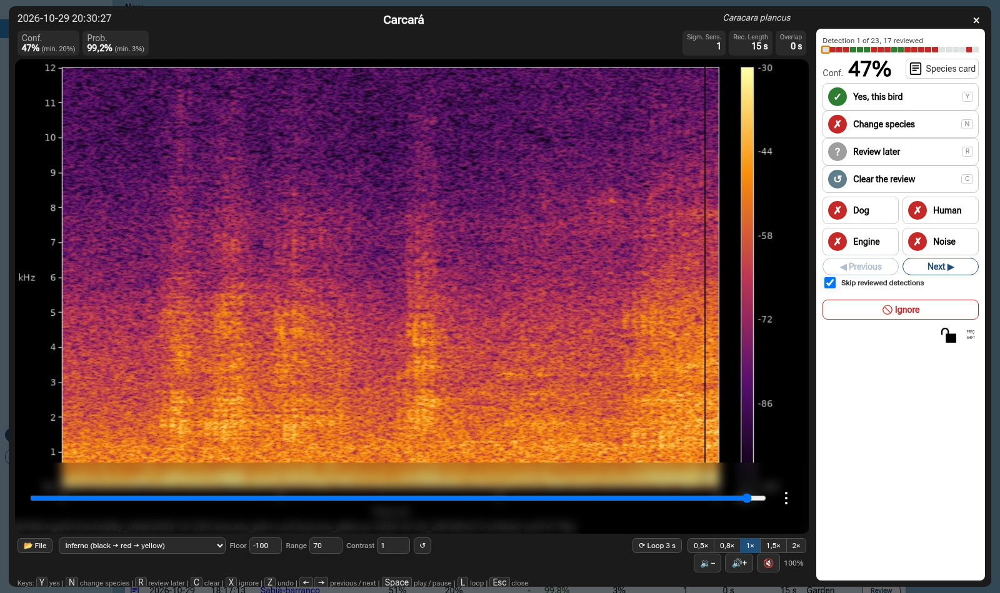</td>
</tr>
<tr>
<td align="center"><b>By Hour — every species by half hour</b><br>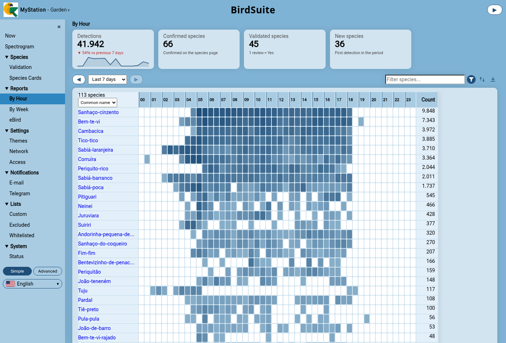</td>
<td align="center"><b>By Week — the year by calendar week</b><br>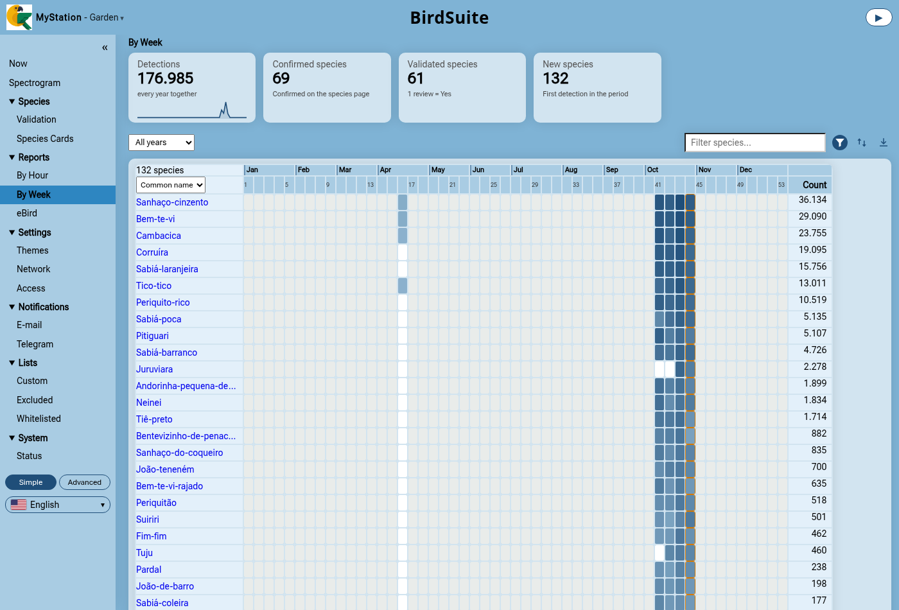</td>
</tr>
<tr>
<td align="center"><b>Species Pages — every species, its settings and lists</b><br>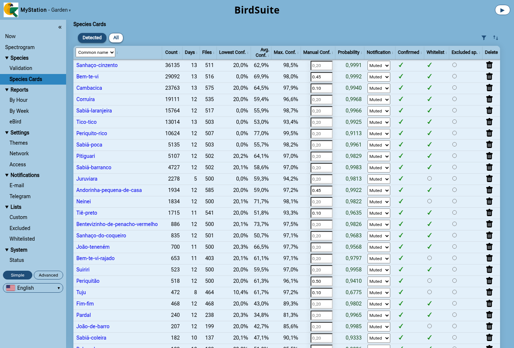</td>
<td align="center"><b>A page for every species</b><br>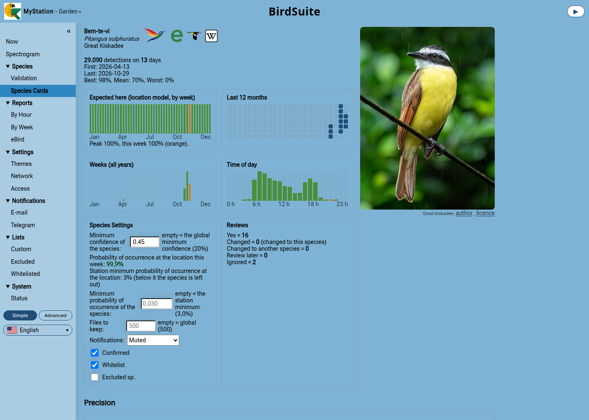</td>
</tr>
<tr>
<td align="center"><b>Lists — available species by group and region</b><br>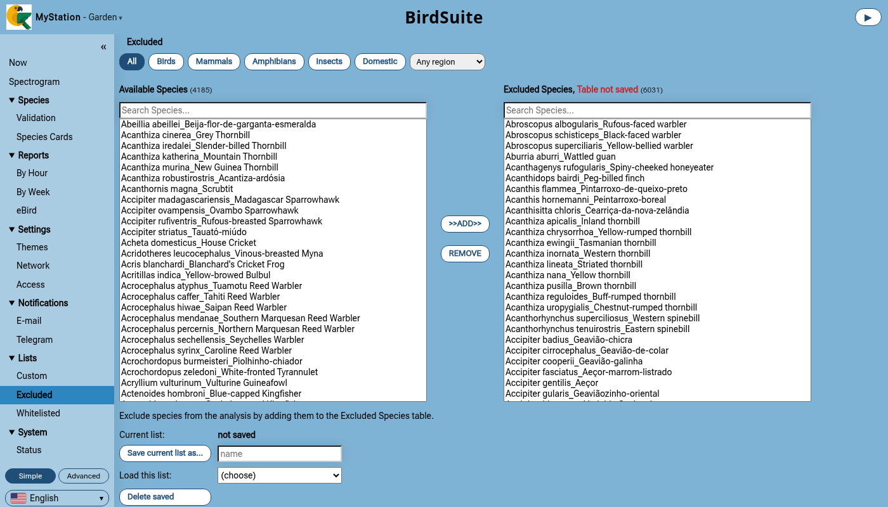</td>
<td align="center"><b>Theme — colour themes</b><br>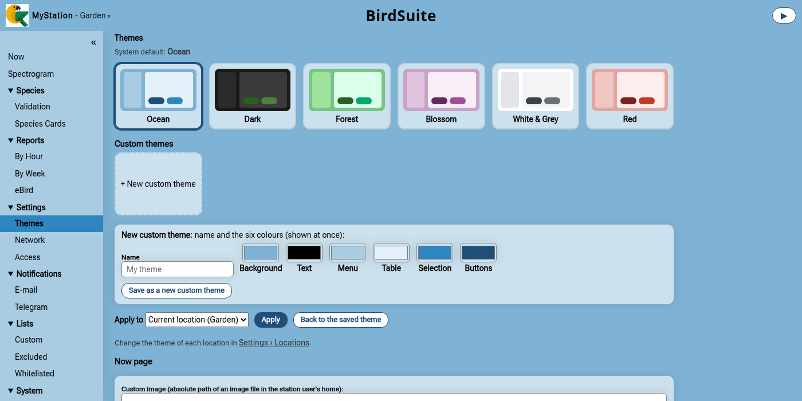</td>
</tr>
<tr>
<td align="center"><b>Station Doctor</b><br>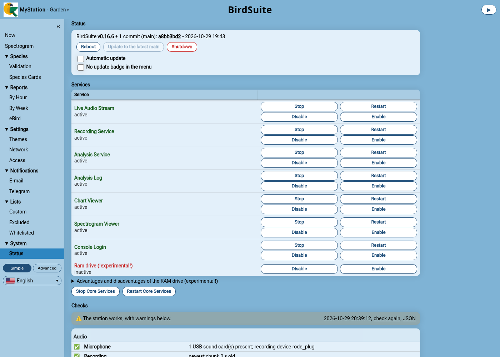</td>
<td align="center"><b>Live spectrogram — palettes and detection labels</b><br>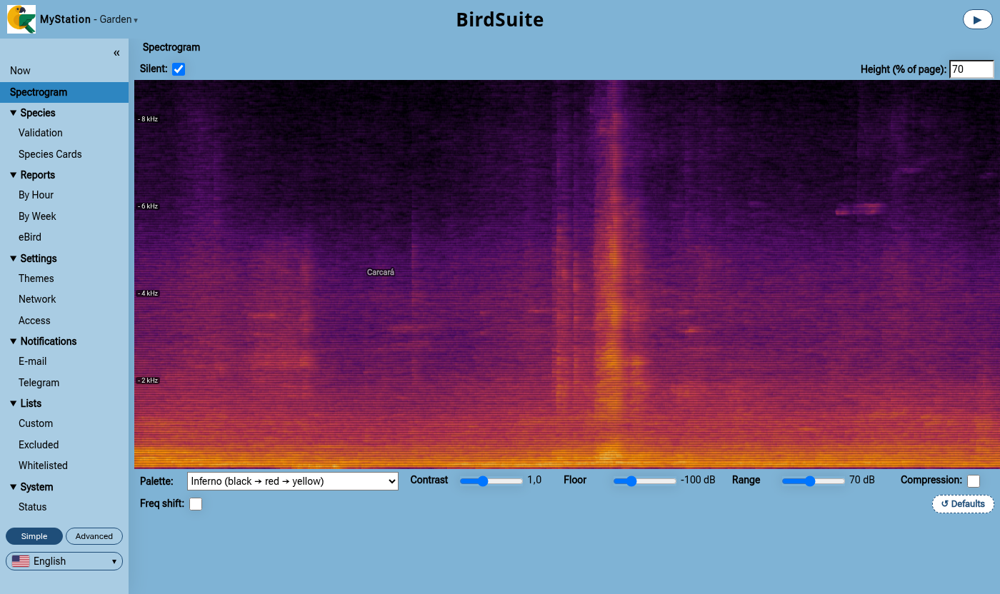</td>
</tr>
<tr>
<td align="center"><b>Settings — models, shadow model and species filter</b><br>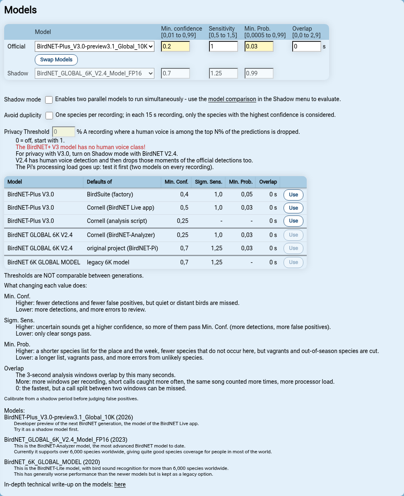</td>
<td align="center"><b>Notifications — Normal and Prio, quiet hours, region-rare alerts</b><br>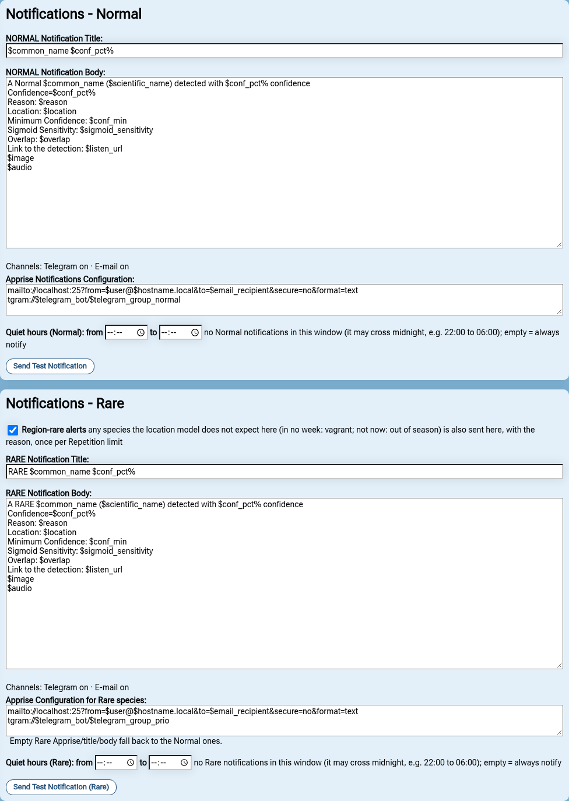</td>
</tr>
<tr>
<td colspan="2" align="center"><b>eBird — the species of a day, a week or a month, the eBird file and the confirmed sounds</b><br>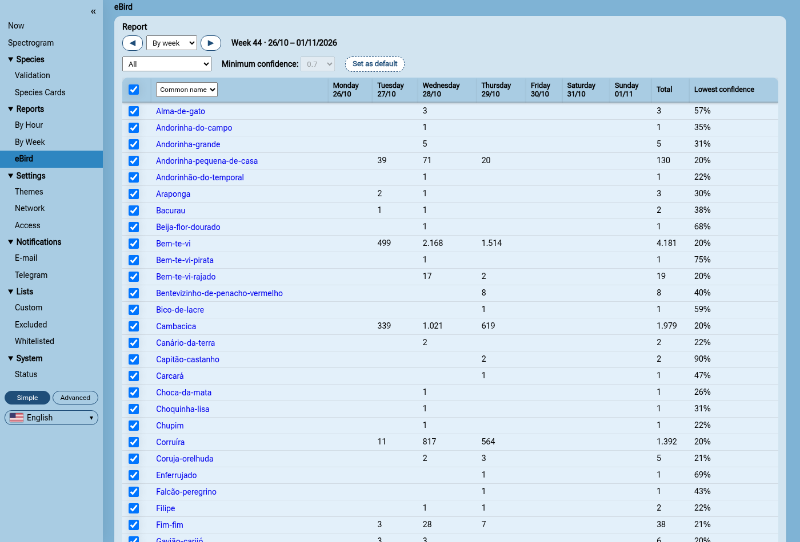</td>
</tr>
<tr>
<td colspan="2" align="center"><b>Stations — the map of the stations and their locations, the list beside it</b> (example stations)<br>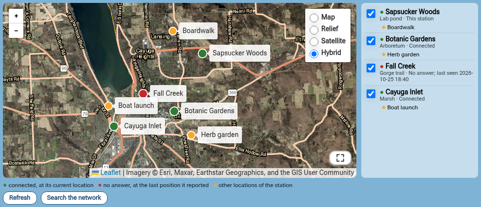</td>
</tr>
</table>

On a phone (the menu opens from the ☰ button):

<table>
<tr>
<td align="center"><b>Now</b><br>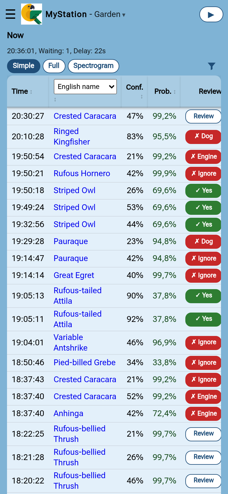</td>
<td align="center"><b>Species page</b><br>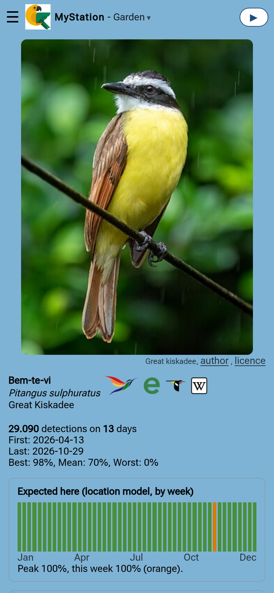</td>
<td align="center"><b>Stations map</b> (example)<br>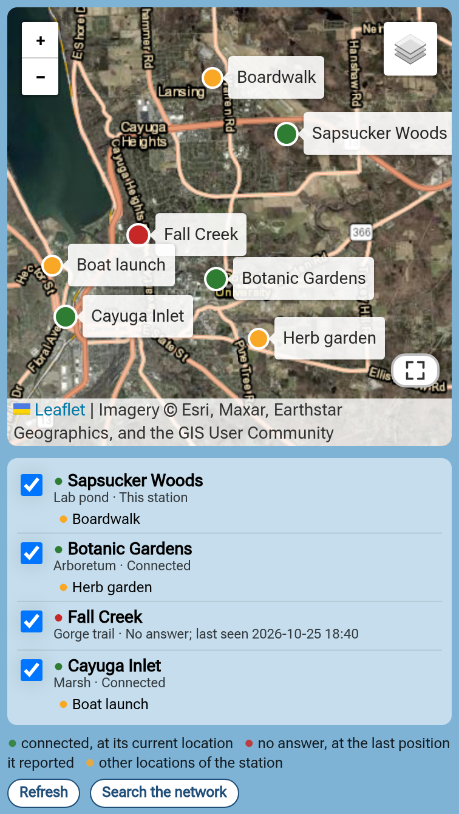</td>
</tr>
</table>

### Reporting issues

- Matters specific to **BirdSuite** (the stories above, the upgrade package): please open an
  [issue in this repository](https://github.com/EvaldoOliveira/BirdSuite/issues/new/choose) — user story, defect or epic.
- Behaviour that also occurs on a standard installation belongs to
  [Nachtzuster's tracker](https://github.com/Nachtzuster/BirdNET-Pi/issues).
- Neither project adjudicates detections: questions about the classification performance of the BirdNET models
  should be addressed to the [BirdNET team](https://github.com/birdnet-team).

### Data sources

- **Species type and region** of the list filters: [GBIF.org](https://www.gbif.org) — the GBIF Backbone Taxonomy (class of each label) and GBIF occurrence records (share of records per continent; 'Global' = four or more continents, 'Ocean' = mostly records at sea), queried through the GBIF API on 2026-10-09 by `scripts/build_species_info.py`. Labels GBIF does not know under the model's name (recent genus changes) are looked up under the name of the other model, else typed from the BirdNET+ labels table. GBIF data is published under CC0 / CC BY licences by its data publishers.
- **Field-guide (taxonomic) order** of the species tables: the [eBird/Clements taxonomy](https://www.birds.cornell.edu/clementschecklist/) (Cornell Lab of Ornithology) — its TAXON_ORDER sequence, order and family, downloaded on 2026-10-10 by `scripts/build_taxonomy_order.py` into `model/taxonomy_order.csv`; a bird missing under the model's name takes its genus' place, non-birds follow the birds.

- **Biome and ecoregion** of each location: [RESOLVE Ecoregions 2017](https://ecoregions.appspot.com/) (Dinerstein et al. 2017, *An Ecoregion-Based Approach to Protecting Half the Terrestrial Realm*, BioScience 67:534), CC BY 4.0, 14 biomes and 846 ecoregions simplified to about 3 km in `model/maps/ecoregions.json.gz`; in Brazil also the IBGE [Biomas do Brasil](https://www.ibge.gov.br/geociencias/informacoes-ambientais/estudos-ambientais/15842-biomas.html) 1:250.000 (2019), simplified to about 1 km in `model/maps/br-biomes.json.gz`.

- **Land cover** of each location: [ESA WorldCover 2021 v200](https://esa-worldcover.org/) (Zanaga et al. 2022, 10 m, CC BY 4.0), read online from its public AWS Open Data copy by `scripts/land_cover.py` (only the block holding the point).

### Licence and credits

[CC BY-NC-SA 4.0](LICENSE), inherited from BirdNET-Pi and from the BirdNET models — **non-commercial use only**,
share alike, with attribution. This edition stands on the work of
[@mcguirepr89](https://github.com/mcguirepr89) (BirdNET-Pi), [@Nachtzuster](https://github.com/Nachtzuster) (the
maintained fork BirdSuite is based on), [@kahst](https://github.com/kahst) and the
[BirdNET team](https://github.com/birdnet-team) at the K. Lisa Yang Center for Conservation Bioacoustics (Cornell Lab
of Ornithology) and Chemnitz University of Technology (the BirdNET models), and every contributor credited in the
sections below.

---

# BirdNET-Pi — standard information (from the upstream README)

The sections below come from Nachtzuster's README and apply to BirdSuite unchanged, unless a note says otherwise.

## About Nachtzuster's fork
Nachtzuster built on [mcguirepr89's](https://github.com/mcguirepr89/BirdNET-Pi) work to update and improve
BirdNET-Pi. His changes, all included here:

 - Backup & Restore
 - Web ui is much more responsive
 - Daily charts now include all species, not just top/bottom 10
 - Bump apprise version, so more notification type are possible
 - Swipe events on Daily Charts (by @croisez)
 - Support for 'Species range model V2.4 - V2'
 - Bookworm and Trixie support
 - Experimental support for writing transient files to tmpfs
 - Rework analysis to consolidate analysis/server/extraction. Should make analysis more robust and slightly more efficient, especially on installations with a large number of recordings
 - Bump tflite_runtime to 2.17.1, it is faster
 - Rework daily_plot.py (chart_viewer) to run as a daemon to avoid the very expensive startup
 - Lots of fixes & cleanups

## Introduction
BirdNET-Pi is built on the [BirdNET framework](https://github.com/kahst/BirdNET-Analyzer) by [**@kahst**](https://github.com/kahst) <a href="https://creativecommons.org/licenses/by-nc-sa/4.0/"></a> using [pre-built TFLite binaries](https://github.com/PINTO0309/TensorflowLite-bin) by [**@PINTO0309**](https://github.com/PINTO0309) . It is able to recognize bird sounds from a USB microphone or sound card in realtime and share its data with the rest of the world.

Check out birds from around the world
- [BirdWeather](https://app.birdweather.com)<br>

## Features
* **24/7 recording and automatic identification** of bird songs, chirps, and peeps using BirdNET machine learning
* **Automatic extraction and cataloguing** of bird clips from full-length recordings
* **Tools to visualize your recorded bird data** and analyze trends
* **Live audio stream and spectrogram**
* **Automatic disk space management** that periodically purges old audio files
* [BirdWeather](https://app.birdweather.com) integration -- you can request a BirdWeather ID from the "Settings" > "Repositories" page
* Web interface access to all data and logs provided by [Caddy](https://caddyserver.com)
* [GoTTY](https://github.com/yudai/gotty) and [GoTTY x86](https://github.com/sorenisanerd/gotty) Web Terminal
* No web file manager: the station's folders open over SFTP in your own file manager (Dolphin, Kate, WinSCP)
* FTP server included
* SQLite3 Database
* [Adminer](https://www.adminer.org/) database editor (Tools › Database › Advanced editor)
* [phpSysInfo](https://github.com/phpsysinfo/phpsysinfo)
* [Apprise Notifications](https://github.com/caronc/apprise) supporting 90+ notification platforms
* Localization supported

## Requirements
* A Raspberry Pi 5, Raspberry 4B, Raspberry Pi 400, Raspberry Pi 3B+, or Raspberry Pi 0W2 (The 3B+ and 0W2 must run on RaspiOS-ARM64-**Lite**)
* An SD Card with the **_64-bit version of RaspiOS_** installed (please use Trixie) -- Lite is recommended, but the installation works on RaspiOS-ARM64-Full as well. Downloads available within the [Raspberry Pi Imager](https://www.raspberrypi.com/software/).
* A USB Microphone or Sound Card

## Installation
[A comprehensive installation guide is available here](https://github.com/mcguirepr89/BirdNET-Pi/wiki/Installation-Guide). This guide is slightly out-dated: make sure to pick Bookworm, also the curl command is still pointing to mcguirepr89's repo.

Please note that installing BirdNET-Pi on top of other servers is not supported. If this is something that you require, please open a discussion for your idea and inquire about how to contribute to development.

[Raspberry Pi 3B[+] and 0W2 installation guide available here](https://github.com/mcguirepr89/BirdNET-Pi/wiki/RPi0W2-Installation-Guide)

To install BirdSuite, follow [How to get BirdSuite](#how-to-get-birdnetpi). The installer takes care of
any and all necessary updates, so you can run it as the very first command upon the first boot.

The installation creates a log in `$HOME/installation-$(date "+%F").txt`.

## Access
BirdSuite can be accessed from any web browser on the same network:
- **http://birdsuite.local** or the station's own **http://birdsuite-&lt;MAC&gt;.local**, on any network: the name
  follows the station when its address changes (see [Open the station](#option-1--new-installation-blank-microsd-card), step 4);
  the IP address only for a device without mDNS names. https is switched on only for a moment while the map reads the
  device's GPS, or always with HTTPS_ALWAYS = 1 in *Tools › Defaults*
- Basic Authentication user name: birdsuite (stations installed before 2026-10-23 also accept birdnet)
- Password: birdsuite on a new station (the installer asks: Enter keeps it, `none` leaves the station without a password). Change it in "Settings" > "Advanced Settings"; while it is still BirdSuite, Status warns. The login dialog names the user (birdsuite)

Please take a look at the [wiki](https://github.com/mcguirepr89/BirdNET-Pi/wiki) and [discussions](https://github.com/mcguirepr89/BirdNET-Pi/discussions) for information on
- [BirdNET-Pi's Deep Convolutional Neural Network(s)](https://github.com/mcguirepr89/BirdNET-Pi/wiki/BirdNET-Pi:-some-theory-on-classification-&-some-practical-hints)
- [making your installation public](https://github.com/mcguirepr89/BirdNET-Pi/wiki/Sharing-Your-BirdNET-Pi)
- [backing up and restoring your database](https://github.com/mcguirepr89/BirdNET-Pi/wiki/Backup-and-Restore-the-Database)
- [adjusting your sound card settings](https://github.com/mcguirepr89/BirdNET-Pi/wiki/Adjusting-your-sound-card)
- [suggested USB microphones](https://github.com/mcguirepr89/BirdNET-Pi/discussions/39)
- [building your own microphone](https://github.com/DD4WH/SASS/wiki/Stereo--(Mono)-recording-low-noise-low-cost-system)
- [privacy concerns and options](https://github.com/mcguirepr89/BirdNET-Pi/discussions/166)
- [beta testing](https://github.com/mcguirepr89/BirdNET-Pi/discussions/11)
- [and more!](https://github.com/mcguirepr89/BirdNET-Pi/discussions)

## Updating 

Use the web interface and go to "System" > "Status" > "Update". If you encounter any issues with that, or suspect that the update did not work for some reason, please save its output and post it in an issue where we can help.

> **Note for BirdSuite:** the web updater follows the release channel set by `UPDATE_BRANCH` in `config/BirdSuite.conf`
> (`main`, the latest commit, by default; `stable` = only the releases) on the `origin` remote of the installation; an installation switched with
> `update_birdnet.sh -r evaldo -b stable` is updated by running that same command again.

## Backup and Restore
Use the web interface and go to "Tools" > "Backup/Restore": **Backup data** saves the folder `~/BirdNET-Pi/config/` (settings, species lists, notifications, locations, the database, the station layer) and the audio (`BirdSongs/Extracted/By_Date` and `Charts`); **Backup settings** saves `config/` only, a small file made in seconds while the station runs (the database is copied through SQLite's own backup). **Restore data** takes either file: it replaces `config/` (keeping this installation's `factory_defaults.conf`) and, when the file has it, the audio. The running state (`~/BirdNET-Pi/state/`) is never saved. A full backup depends on the size of the audio and the speed of the storage, and can take quite a while.

Alternatively, the backup script can be used directly. These examples assume the backup medium is mounted on `/mnt`

To backup (`-m config` = without the audio):
```commandline
./scripts/backup_data.sh -a backup -f /mnt/birds/backup-2024-07-09.tar
./scripts/backup_data.sh -a backup -f /mnt/birds/backup-config-2024-07-09.tar -m config
```
To restore:
```commandline
./scripts/backup_data.sh -a restore -f /mnt/birds/backup-2024-07-09.tar
```

## x86_64 support
x86_64 support is mainly there for developers or otherwise more Linux savvy people.
That being said, some pointers:
- Use Debian 12 or 13
- The user needs passwordless sudo

For Proxmox, a user has reported adding this in their `cpu-models.conf`, in order for the custom TFLite build to work.
```
cpu-model: BirdNet
    flags +sse4.1
    reported-model host
```

## Uninstallation
```
/usr/local/bin/uninstall.sh && cd ~ && rm -drf BirdNET-Pi
```

## Migrating
Before switching, make sure your installation is fully up-to-date. Also make sure to have a backup, that is also the only way to get back to the original BirdNET-Pi.
Please note that upgrading your underlying OS to Bookworm is not going to work. Please stick to Bullseye. If you do want Bookworm, you need to start from a fresh install and copy back your data. (remember the backup!)

To move an existing installation to BirdSuite, see
[Option 2 — Upgrade an existing Nachtzuster installation](#option-2--upgrade-an-existing-nachtzuster-installation).

## Troubleshooting and Ideas
*Hint: A lot of weird problems can be solved by simply restarting the core services. Do this from the web interface "System" > "Services" > "Restart Core Services"*

For BirdSuite see [Reporting issues](#reporting-issues). For a standard installation, Nachtzuster asks: submit an *issue for trouble* and a *discussion for ideas*, search the repository before creating a new one, and do not open issues about "false positives" — the repository has nothing to do with the validity of the detection results.

## Sharing
Please join a Discussion!! and please join [BirdWeather!!](https://app.birdweather.com)
I hope that if you find BirdNET-Pi has been worth your time, you will share your setup, results, customizations, etc. [HERE](https://github.com/mcguirepr89/BirdNET-Pi/discussions/69) and will consider [making your installation public](https://github.com/mcguirepr89/BirdNET-Pi/wiki/Sharing-Your-BirdNET-Pi).

## Homeassistant addon

BirdNET-Pi can also be run as a [Homeassistant](https://www.home-assistant.io/) addon through docker.
For more information : https://github.com/alexbelgium/hassio-addons/blob/master/birdnet-pi/README.md

## Docker

BirdNET-Pi can also be run as as a docker container.
For more information : https://github.com/alexbelgium/hassio-addons/blob/master/birdnet-pi/README_standalone.md

## Cool Links

- [Marie Lelouche's <i>Out of Spaces</i>](https://www.lestanneries.fr/exposition/marie-lelouche-out-of-spaces/) using BirdNET-Pi in post-sculpture VR! [Press Kit](https://github.com/mcguirepr89/BirdNET-Pi-assets/blob/main/dp_out_of_spaces_marie_lelouche_digital_05_01_22.pdf)
- [Research on noded BirdNET-Pi networks for farming](https://github.com/mcguirepr89/BirdNET-Pi-assets/blob/main/G23_Report_ModelBasedSysEngineering_FarmMarkBirdDetector_V1__Copy_.pdf)
- [PixCams Build Guide](https://pixcams.com/building-a-birdnet-pi-real-time-acoustic-bird-id-station/)
- [Core-Electronics](https://core-electronics.com.au/projects/bird-calls-raspberry-pi) Build Article
- [RaspberryPi.com Blog Post](https://www.raspberrypi.com/news/classify-birds-acoustically-with-birdnet-pi/)
- [MagPi Issue 119 Showcase Article](https://magpi.raspberrypi.com/issues/119/pdf)


### Internationalization:
The bird names are in English by default, but other localized versions are available thanks to the wonderful efforts of [@patlevin](https://github.com/patlevin) and Wikipedia. Use the web interface's "Settings" > "Model" and select your "Common name Language" to have the detections in your language.

[Internationalization](docs/translations.md)


## :thinking:
Are you a lucky ducky with a spare Raspberry Pi? [Try Folding@home!](https://foldingathome.org/)
